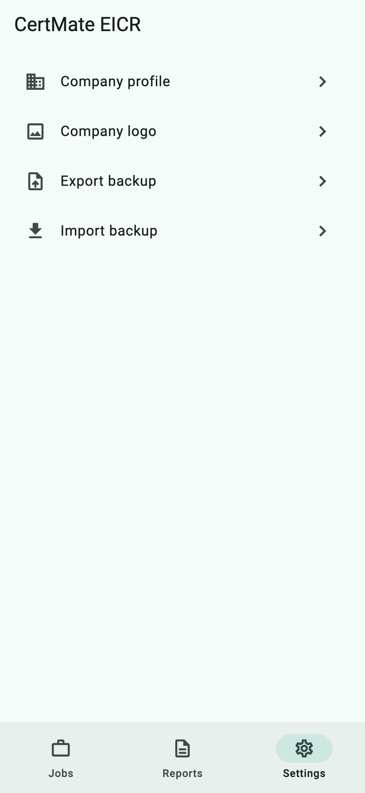
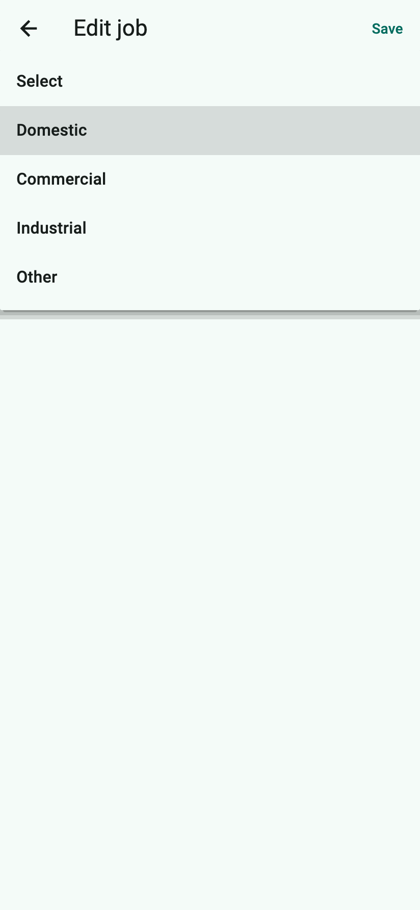
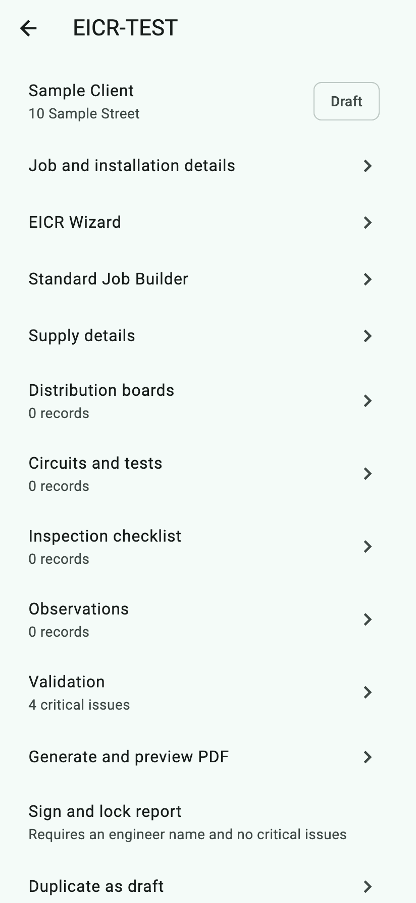
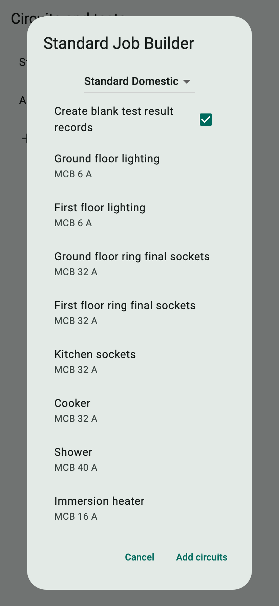
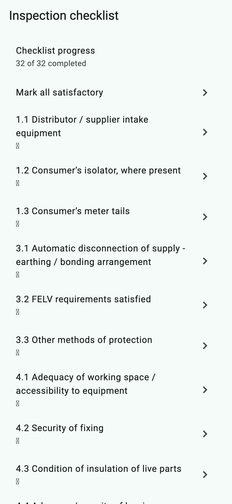
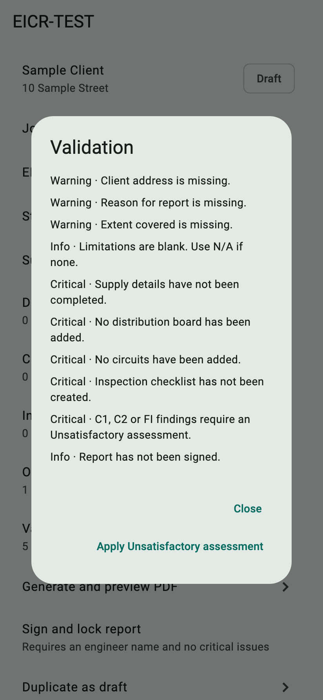

# CertMate EICR user guide

Use CertMate EICR to record an electrical installation condition report, review the findings, and produce a PDF. Jobs are stored on the device. Use **Settings → Export backup** to keep a separate copy of your records.

- [Set up your company profile](#set-up-your-company-profile)
- [Create or find a job](#create-or-find-a-job)
- [Record the inspection](#record-the-inspection)
- [Validate, sign, and share](#validate-sign-and-share)
- [Duplicate a job](#duplicate-a-job)
- [Back up or restore records](#back-up-or-restore-records)

## Set up your company profile

Open **Settings → Company profile**. Enter your company name, address, phone number, and email, then tap **Save**. Use **Company logo** to choose an image. New jobs pick up your saved company details. To update an existing draft, open the job and select **Apply saved company profile**.

## Create or find a job

1. Open **Jobs** and tap **New job**.
2. Enter the client and installation details. Open **Premises type** and choose **Domestic**, **Commercial**, **Industrial**, or **Other**. New jobs default to **Domestic**.
3. Tap **Save**. Open **Job and installation details** to edit the draft later. Use **EICR Wizard** to enter the reason for the report, extent covered, limitations, and overall assessment.

To find an existing job, search by client, report number, or installation address on the **Jobs** tab.

## Record the inspection

### Supply, boards, and circuits

1. Open **Supply details**, enter the installation supply and earthing information, then tap **Save**.
2. Open **Distribution boards** and tap **Add board**. Enter the board reference and details, then save.
3. Open **Circuits and tests**. Use **Add circuit** for manual entry or **Add circuit preset** for a single preset. To add a set, open **Standard Job Builder**, select **Standard Domestic**, **Small Flat**, or **Larger House**, and review the preview. Select **Create blank test result records** if you want a test record for each added circuit.
4. Open each circuit, select **Test results**, enter the readings and results, then save.

### Checklist and observations

- Open **Inspection checklist** and select **Create default checklist**. Open each item to assign a result and add notes. **Checklist progress** shows how many items have results. **Mark all satisfactory** overwrites every checklist result after confirmation. Use it only after verifying that every item is satisfactory.
- Open **Observations** and select **Add observation**. Record the location, description, classification, and recommendation. Save and reopen the observation to **Choose photo** or **Take photo** on supported mobile devices. Add a caption if needed. Use **Replace photo** or the delete icon to manage attachments on a draft.

## Validate, sign, and share

1. Open **Validation** from the job. Review critical issues, warnings, and information messages, then return to the relevant sections to address them. Where C1, C2, or FI findings require an Unsatisfactory assessment, the validation screen offers **Apply Unsatisfactory assessment**.
2. Enter the engineer’s name under **Job and installation details**. When there are no critical issues, select **Sign and lock report**, draw your signature, and tap **Sign**. The signed job is locked for editing.
3. Select **Generate and preview PDF** to save a PDF snapshot. Use the preview’s save, print, or share controls as available on your device.
4. Open **Reports** to reopen the saved PDF. If you change a draft after generating its PDF, generate it again to update the saved copy.

## Duplicate a job

Open a job and select **Duplicate as draft**. Choose whether to copy circuits, test results, observations, and photos. Select **Clear test readings** if you want blank test records for a new inspection. Tap **Continue**, review the client and installation details, and tap **Save**. The copy has a new report number and can be edited and signed separately.

## Back up or restore records

- **Export backup** saves a JSON backup through your device’s file picker. Keep a copy somewhere you can access if you replace your device.
- **Import backup → Merge with existing data** adds records from the backup while retaining local records with matching identifiers.
- **Import backup → Replace all existing data** replaces local jobs and settings with the selected backup after confirmation. Export your current data first if you might need it later.

To move jobs from the original Swift app, export a JSON backup there and import it here. Swift backups omit supply details, the separate company profile, and saved PDFs. Re-enter the missing details and generate new PDFs as needed.
